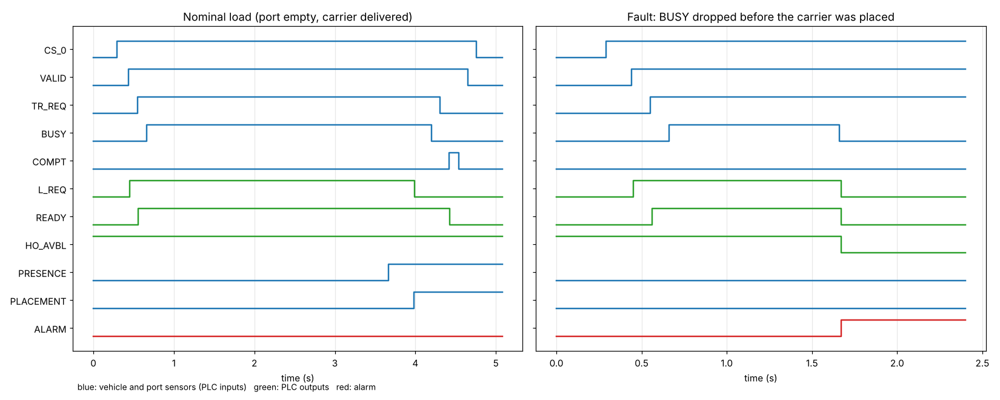

# SEMI E84 Load-Port Handshake on a PLC (IEC 61131-3 Structured Text)

[](https://github.com/vansh0906/e84-plc-handshake/actions/workflows/ci.yml)

**SEMI E84** is the parallel-I/O handshake an overhead hoist transport (OHT) vehicle and a tool's load port use to hand a wafer carrier over safely. This project implements the **load-port side as a PLC program in IEC 61131-3 Structured Text**, compiles it with **matiec** (the compiler inside OpenPLC), and tests it against a simulated vehicle with 12 injected faults. The same program runs live in **OpenPLC**, with the vehicle simulator talking to it over **Modbus TCP**.



## The handshake

```
 AMHS (vehicle)                         Load port (this PLC)
 CS_0 on, VALID on        ──────────▶
                          ◀──────────   L_REQ on   (empty port; U_REQ to unload)
 TR_REQ on                ──────────▶
                          ◀──────────   READY on
 BUSY on (hoist moving)   ──────────▶
                          ◀──────────   L_REQ off  (sensors: carrier present and seated)
 BUSY off, TR_REQ off, COMPT on ─────▶
                          ◀──────────   READY off
 COMPT off, VALID off, CS_0 off ─────▶  carrier clamped, hand-off counted
```

The program watches every step with the passive timers (TP1 2 s, TP2 2 s, TP3 60 s, TP4 60 s, TP5 2 s; defaults as in common E84 test tools) and checks the protocol on every 10 ms scan. On a timeout, a protocol violation or an E-stop, it drops L_REQ, U_REQ, READY and HO_AVBL **in the same scan**, latches an alarm code and waits for an operator reset.

| Alarm | Meaning |
|---|---|
| 1-5 | TP1-TP5 timeout |
| 6 | carrier present but not seated when TP3 ran out |
| 11 | VALID or CS_0 lost during a hand-off |
| 12 | TR_REQ dropped before BUSY |
| 13 | BUSY dropped before the carrier was placed or removed |
| 14 | carrier sensors changed after the transfer |
| 80 | TR_REQ, BUSY or COMPT on without VALID |
| 90 | emergency stop |

## Files

| Path | What it is |
|---|---|
| `plc/e84_load_port.st` | The `E84_LOAD_PORT` function block: state machine, timers, alarms |
| `plc/wrap_sim.st` | Program for OpenPLC simulation: I/O packed into `%MW0` / `%MW1` for Modbus |
| `plc/wrap_io.st` | Program for real hardware: E84 signals on `%IX` / `%QX` |
| `openplc/e84_sim.st`, `openplc/e84_io.st` | Ready-to-upload files for OpenPLC (CI checks they match the sources) |
| `plc/glue.c`, `Makefile` | Compile with matiec and build a library Python can scan, one 10 ms cycle at a time |
| `sim/oht.py` | The vehicle (active side) with TA1-TA3 timeouts, the port's carrier sensors, and 12 fault modes |
| `sim/run_all.py` | All scenarios and the requirement table; `sim/tests.py` quick checks |
| `sim/live.py`, `sim/fake_openplc.py` | Real-time run over Modbus TCP against OpenPLC (or a local stand-in) |

## Results

<!-- results:start -->
```text
PLC: E84_LOAD_PORT compiled from IEC 61131-3 ST by matiec; task interval 10 ms

[1  Nominal hand-offs]
  load  : complete, 14 signal edges in E84 order: yes, hand-off took 4.47 s (3 s of it hoist travel), CLAMP after: True
    CS_0+ VALID+ L_REQ+ TR_REQ+ READY+ BUSY+ L_REQ- BUSY- TR_REQ- COMPT+ READY- COMPT- VALID- CS_0-
  unload: complete, 14 signal edges in E84 order: yes, hand-off took 4.50 s (3 s of it hoist travel), CLAMP after: False
    CS_0+ VALID+ U_REQ+ TR_REQ+ READY+ BUSY+ U_REQ- BUSY- TR_REQ- COMPT+ READY- COMPT- VALID- CS_0-

[2  Injected faults: what the PLC flagged and how fast]
  timeouts: time from entering the waiting state to the alarm; violations: time from the bad signal to the alarm
  fault            expected   got  detected after  safe outputs  recovery
  no_tr_req               1     1   2.02 s (TP 2)           yes  ok   TP1 timeout: no TR_REQ
  no_busy                 2     2   2.02 s (TP 2)           yes  ok   TP2 timeout: no BUSY
  hoist_jam               3     3 60.02 s (TP 60)           yes  ok   TP3 timeout: carrier not placed/removed
  tilted                  6     6 60.02 s (TP 60)           yes  ok   carrier present but not seated
  no_compt                4     4 60.02 s (TP 60)           yes  ok   TP4 timeout: no COMPT
  valid_stuck             5     5   2.02 s (TP 2)           yes  ok   TP5 timeout: VALID not released
  valid_drop             11    11           10 ms           yes  ok   VALID or CS_0 lost during hand-off
  tr_req_drop            12    12           10 ms           yes  ok   TR_REQ dropped before BUSY
  busy_early             13    13           10 ms           yes  ok   BUSY dropped before carrier placed/removed
  sensor_flicker         14    14           10 ms           yes  ok   carrier sensors changed after transfer
  no_valid               80    80           10 ms           yes  ok   AMHS signal without VALID
  estop                  90    90           10 ms           yes  ok   emergency stop

[3  Port out of service]
  HO_AVBL False, L_REQ raised: False, PLC alarm: False; vehicle: TA1: port never offered a hand-off (HO_AVBL off)

[4  Endurance: 100 alternating load / unload hand-offs]
  completed 100/100, PLC hand-off counter 100, alarms 0, CLAMP held while loaded and released for unload: True, simulated time 8.4 min

ID   Requirement                                                            Result   Target  Status
R1   Load and unload complete with E84 signal order                             2/2     2/2  PASS
R2   Each injected fault raises the right alarm code                          12/12   12/12  PASS
R3   Timeout faults flagged at their timer (within +30 ms)                      6/6     6/6  PASS
R4   Protocol violations flagged within 2 scans (20 ms)                         6/6     6/6  PASS
R5   L_REQ, U_REQ, READY, HO_AVBL off on every alarm; ES off on E-stop        12/12   12/12  PASS
R6   Reset, then a clean hand-off, after every fault                          12/12   12/12  PASS
R7   Out-of-service port refuses hand-offs without alarming                     yes     yes  PASS
R8   100 alternating hand-offs, no alarm, counter matches                   100/100 100/100  PASS
R9   Carrier clamped after load, unclamped for unload                           yes     yes  PASS
9/9 requirements pass
saved timing.png
```
<!-- results:end -->

## Run it

**Tests (Mac or Linux, with Docker):**
```bash
docker build -f Dockerfile.test -t e84-test .
docker run --rm -v "$PWD":/app e84-test        # results.txt and timing.png land in this folder
```

**Live in OpenPLC:**
```bash
git clone --depth 1 https://github.com/thiagoralves/OpenPLC_v3.git ~/OpenPLC_v3
cd ~/OpenPLC_v3 && docker build -t openplc .
docker run -d --name openplc -p 8080:8080 -p 502:502 openplc
# browser: http://localhost:8080 (openplc / openplc) -> Programs -> upload openplc/e84_sim.st -> Start PLC
python3 sim/live.py --host 127.0.0.1 --port 502
```

## Limitations

- Load-port (passive) side only, single port (CS_0), no continuous hand-off (CONT) and no CS_1.
- Signal order and timer defaults follow published E84 tool documentation, not the SEMI standard text itself; a real port's timer values come from the tool's own specification.
- The vehicle and carrier sensors are simulated. On real hardware, the inputs would come through optically isolated E84 I/O.
